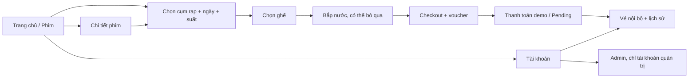
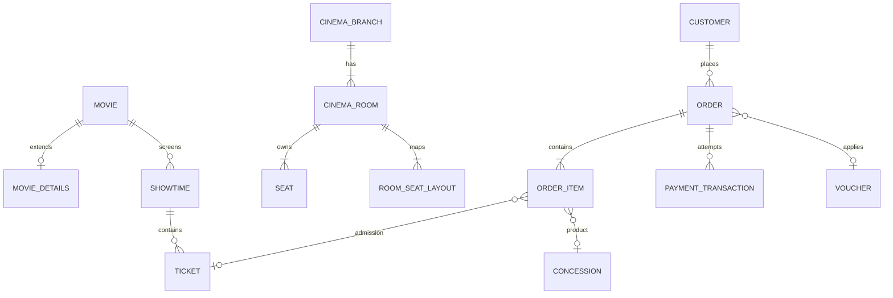

# OOP Cinema 2.0 — đặc tả sản phẩm và thiết kế 4A

**Trạng thái:** đề xuất để TV1 review; chưa phải hợp đồng API đã chốt. **Ngày khảo sát:** 2026-11-25 (Asia/Saigon). **Phạm vi PR 4A:** tài liệu và mockup, không sửa nghiệp vụ, dữ liệu hay GUI chạy thật.

## 1. Mục tiêu và ranh giới

OOP Cinema là ứng dụng desktop Windows x64 dùng C++17, Qt 6 Widgets và CMake để trình diễn một hành trình đặt vé có thể giải thích bằng OOP. Người xem tìm phim, chọn cụm rạp **mô phỏng thuộc OOP Cinema**, ngày/suất/ghế, thêm bắp nước, xem giá cuối, thực hiện thanh toán **demo**, rồi nhận vé nội bộ. Admin có khu vực riêng để quản lý dữ liệu mô phỏng. Console và các test hiện có tiếp tục hoạt động.

Không trình bày lịch chiếu, tồn kho ghế, giá hoặc QR của OOP Cinema như dữ liệu của Galaxy/CGV. Không có giao dịch ngân hàng thật. Không đưa ảnh poster/trailer vào repository nếu chưa xác minh giấy phép. Mockup ở `docs/mockups/oop-cinema-v2.html` chỉ dùng minh họa CSS tự tạo và nhãn **phim mẫu**; nút trong đó mô phỏng điều hướng thiết kế, không tạo đơn thật.

### Tiêu chí nghiệm thu dự kiến

| Mục | Điều kiện |
| --- | --- |
| Mua vé | Phim → cụm rạp/ngày/suất → 1–8 ghế → bắp nước tùy chọn → checkout → vé; không có bước mất lựa chọn khi quay lại. |
| Ghế | 80–120 ghế/phòng tiêu chuẩn, lối đi rõ; trạng thái theo `(showtimeId, seatId)`; không đặt trùng; suất quá giờ không đặt được. |
| Giá | VND nguyên; giá vé theo suất + phụ thu hạng ghế; bắp nước/voucher có dòng riêng, tổng không âm và được chốt khi tạo đơn. |
| Dữ liệu | Phim và metadata cập nhật từ bản lưu, không nhúng trong QWidget; V1 vẫn đọc được, V2 có migration và kiểm thử lỗi/khôi phục. |
| UI | Không còn sidebar quản trị trong hành trình mua vé; bố cục dùng được ở 860×620, 1120×760 và maximized; có trạng thái rỗng/lỗi/đang xử lý. |
| Bản Windows | CTest Debug/Release/không Qt, GUI Windows thật và ZIP độc lập; không chứa dữ liệu cá nhân hoặc source. |

## 2. Căn cứ thiết kế và kiểm tra repository

### Hiện trạng đã đọc

- `Movie` chỉ có ID, tựa, thời lượng, thể loại và giá cơ sở; chưa có poster, phân loại tuổi hay tóm tắt. `MovieCatalog` là kho phim.
- `CinemaRoom` sở hữu danh sách `Seat` vật lý; `Seat` chỉ có hàng/số. Chưa có cụm rạp, lối đi hay loại ghế. `Showtime` chứa movieId, roomId, thời gian và giá.
- `BookingManager` kiểm tra khách/suất/phòng/ghế, tạo **một vé cho một ghế**, và có thể gọi `Payment` ngay. `Ticket` lưu một giá; `CinemaDataStore` hiện yêu cầu giá vé bằng giá suất khi tải. Vé Pending giữ ghế; Paid đã đặt; Cancelled trả ghế. Không có kiểm tra suất đã qua giờ trong `bookTicket`.
- `Customer`/`Admin` kế thừa `User`, nhưng không có tài khoản/mật khẩu hoặc phiên đăng nhập. `UiSession` tạo hai phim, một phòng bốn ghế và một khách demo trong constructor; Qt hiện là sidebar sáu trang, chọn khách bằng danh sách.
- `FileStorage` và `CinemaDataStore` đọc/ghi năm file V1 dạng `|`, không có metadata phim/đơn hàng. 3C có vùng ghi tạm và một bản sao `.cinema-backup`, nhưng năm file chính vẫn thay lần lượt. `cinema_core` không phụ thuộc Qt; target console và test phải tiếp tục độc lập.

### Tham khảo trải nghiệm (không sao chép thương hiệu)

Trang [lịch chiếu Galaxy](https://www.galaxycine.vn/lich-chieu/) cho thấy cách nhóm lựa chọn phim/rạp/suất và các bước ghế → thức ăn → thanh toán → xác nhận. [FAQ đặt vé Galaxy](https://www.galaxycine.vn/hoi-dap/) mô tả hành trình chọn phim, rạp, suất, ghế và combo. OOP Cinema chỉ học cách giảm số lần đổi ngữ cảnh: header ngang, thanh chọn nhanh, tiến trình rõ và tóm tắt đơn luôn thấy được. Màu sắc, lưới, icon, nội dung và nhận diện sẽ do nhóm tự thiết kế. Các trang này không cấp phép dùng logo, ảnh hoặc lịch chiếu của họ.

## 3. Cấu trúc màn hình và hành trình

| Màn hình | Nội dung chính | Hành động thật ở giai đoạn triển khai | Trạng thái cần thiết |
| --- | --- | --- | --- |
| Trang chủ | Hero nổi bật, thanh đặt nhanh, lưới đang/sắp chiếu, ưu đãi, footer | Lọc phim và mở chi tiết/suất | Không có phim, ảnh chưa cấp phép, đang tải. |
| Chi tiết phim | Poster hợp lệ hoặc đồ họa thay thế, metadata, nội dung, trailer URL đã kiểm tra | Chọn ngày/suất cho phim | Thiếu metadata/trailer; nút trailer ẩn nếu URL sai. |
| Cụm rạp/lịch | Khu vực → cụm rạp → ngày → suất; địa chỉ, phòng, giá | Chọn showtimeId, vô hiệu suất đã qua giờ | Không có suất phù hợp, thời gian máy sai. |
| Ghế | Sơ đồ vật lý 80–120 ghế, lối đi, chú giải, tóm tắt số ghế/giá | Chọn/bỏ ghế Available, kiểm tra lại trước khi giữ | Ghế vừa bị đặt, phòng sai dữ liệu, cần cuộn. |
| Bắp nước | Sản phẩm, giá, lượng, tổng phụ | Tăng/giảm, bỏ qua | Hết hàng nếu có tồn kho, sản phẩm vô hiệu. |
| Checkout | Người mua, phim/cụm rạp/suất/ghế, các dòng tiền, voucher, thanh toán | Xác nhận đơn, tạo Pending trước xử lý thanh toán | Giá thay đổi, voucher hết hạn, lỗi lưu. |
| Vé của tôi | Mã đơn, trạng thái, phim, suất, ghế, QR nội bộ khi hợp lệ | Xem, thanh toán lại Pending, hủy theo chính sách demo | Chưa có vé; QR không có khi đơn không đủ điều kiện. |
| Tài khoản | Form đăng nhập/đăng ký dạng dialog, hồ sơ | Tạo/chọn phiên người dùng thật theo quyết định TV1 | Không hiển thị danh sách mọi khách trong luồng mua. |
| Admin | Tab riêng cho phim, cụm rạp, phòng, lịch, bắp nước, voucher, đơn, khách | CRUD có kiểm tra tham chiếu và quyền | Không cho xóa đối tượng đang được đơn tham chiếu. |

**Luồng chọn nhanh:** Phim → cụm rạp thuộc khu vực → ngày có suất → suất hợp lệ. Mỗi thay đổi ở bước trước xóa lựa chọn không còn hợp lệ ở bước sau; khi không có dữ liệu, hiển thị lý do và vô hiệu nút tiếp tục. `UiSession` giữ một `BookingDraft` (ID và lượng, không giữ pointer vào vector) để quay lại vẫn còn lựa chọn. Checkout gọi service nghiệp vụ; QWidget chỉ hiển thị kết quả.

**Quy tắc thời gian:** So sánh giờ địa phương Việt Nam với `Showtime::startTime` trước khi giữ ghế và ngay trước xác nhận. Định dạng V1 không có timezone; V2 ghi rõ `Asia/Ho_Chi_Minh` trong cấu hình vận hành. Không tự suy đoán UTC từ chuỗi V1.

## 4. Mô hình dữ liệu đề xuất

| Dữ liệu | Trường bổ sung chủ chốt | Quan hệ và ràng buộc |
| --- | --- | --- |
| `MovieDetails` | movieId, originalTitle?, ageRating?, releaseDate?, director?, cast?, synopsis?, posterAsset?, trailerUrl?, sourceUrl, verifiedAt | Metadata tùy chọn keyed movieId; không sửa constructor `Movie`. Trạng thái đang/sắp chiếu phụ thuộc suất nội bộ và xác minh, không chỉ ngày phát hành. |
| `CinemaBranch` | id, name, area, address, active | Một phòng thuộc đúng một cụm; các cụm là dữ liệu mô phỏng của OOP Cinema. |
| `RoomSeatLayout` | roomId, map seatId → category/aisle/row/column | Ghế vẫn là vật lý; trạng thái nằm ở vé theo suất. Lối đi là vị trí trống, không phải Seat. |
| `SeatCategory` | Standard, VIP, Couple | Đề xuất **enum**, không cần class riêng. Ghế đôi cần quy tắc cặp và đặt cùng lúc hoặc trì hoãn đến khi có thuật toán nguyên tử. |
| `Concession` | id, name, description, unitPriceVnd, asset?, active | Giá không âm; combo là sản phẩm có giá riêng, không tự trừ tồn kho nếu chưa quản lý tồn. |
| `Voucher` | code, loại giảm, giá trị, minSpend, cap, validFrom/To, active, usageLimit? | Giá trị hợp lệ; một mã/đơn; tính sau tổng vé+bắp nước theo quy tắc đã chốt. |
| `Order`/`OrderItem` | ID duy nhất, customerId, showtimeId, trạng thái; item type, refId, quantity, unitPriceSnapshot | Nhiều vé một đơn, bắp nước tùy chọn; dòng giá chốt không đổi theo catalog sau này. |
| `PaymentTransaction` | id, orderId, method, amount, state, createdAt, externalRef? | Demo thành công hoặc Pending; không suy ra Paid từ việc mở màn hình chuyển khoản. |

**Giá và vé cũ:** V1 `Ticket::priceVnd` bằng giá `Showtime`. Đề xuất giữ giá đó là **giá vào cửa cơ bản** để API cũ và file cũ vẫn có nghĩa. Phụ thu VIP/ghế đôi được lưu ở `OrderItem` và `Order::totalVnd`, hiển thị thành dòng riêng. Cần TV1 chốt liệu vé điện tử hiển thị giá cơ bản hay giá đã cộng phụ thu. Không thay nghĩa `Ticket::getPriceVnd()` âm thầm.

**Sở hữu và vòng đời:** `CinemaApplication`/`CinemaSystem` sở hữu các catalog và service theo giá trị hoặc `std::unique_ptr`; `OrderService` giữ tham chiếu không sở hữu vào kho còn sống lâu hơn nó. Truyền ID thay vì giữ pointer vào vector qua lần tải. `UiSession` giữ ID và draft; QWidget không sở hữu model nghiệp vụ. Các `std::vector`, `std::map`, `std::set` quản lý bộ nhớ và tra cứu; không có raw owning pointer.

## 5. Lớp/API đề xuất (chưa sửa `docs/API_CONTRACT.md`)

| Owner dự kiến | Lớp / API mới | Mục đích và lý do |
| --- | --- | --- |
| TV2 | `MovieDetails`, `MovieDetailsCatalog::find(movieId)` | Metadata và nguồn xác minh; giữ nguyên `Movie`. |
| TV3 | `CinemaBranch`, `BranchCatalog`, `RoomSeatLayout::categoryOf(roomId, seatId)` | Nhiều cụm/phòng, hạng ghế và lối đi; không sửa `Seat` nếu không cần. |
| TV4 | `ShowtimeAvailability::isBookable(showtimeId, nowLocal)` hoặc service TV1 | Chặn suất quá giờ và lọc theo ngày/cụm; không sửa `Showtime` V1. Owner cần TV1 và TV4 thống nhất. |
| TV5 | `AccountRecord`, `AccountService` (nếu chọn đăng nhập local) | Tách tài khoản khỏi `Customer`; không coi role demo là xác thực an toàn. |
| TV6 | `Concession`, `ConcessionCatalog`, `Voucher`, `VoucherManager` | Giá sản phẩm và điều kiện voucher, có unit test riêng. |
| TV1 | `PricingService::quote(draft)`, `Order`, `OrderItem`, `OrderService::reserve/confirm/cancel`, `BookingDraft` | Tính giá và điều phối nhiều ghế, thanh toán, đơn; gọi `BookingManager` thay vì sao chép kiểm tra ghế trong Qt. |
| TV1 + TV6 | `PaymentTransaction`, giao diện `PaymentGateway` mới chỉ ở bước 4D | Ghi nhận nỗ lực thanh toán và kết quả xác minh; `Payment` cũ vẫn chạy console/demo. |

**Điểm tích hợp cần thiết ở 4B:** `BookingManager::bookTicket` hiện tạo và thử thanh toán từng ghế, nên không thể dùng thẳng cho đơn nhiều ghế nguyên tử. Đề xuất **bổ sung** `reserveSeats(customerId, showtimeId, seatIds, outTicketIds)` và `settleTickets(ticketIds, verifiedResult)` trong TV1, dùng chung hàm kiểm tra ghế nội bộ với API cũ. `reserveSeats` kiểm tra toàn bộ ghế/cặp ghế trước khi tạo bất kỳ vé nào, tạo toàn bộ Pending hoặc không tạo gì. `settleTickets` chỉ được gọi từ `OrderService` sau kết quả `PaymentGateway` hợp lệ; tuyệt đối không lấy nút UI hoặc `BankTransferPayment::process() == false` làm chứng cứ thanh toán. Chữ ký/chính sách cụ thể phải được TV1 chốt ở 4B và ghi vào API contract trước khi code. Không sửa trực tiếp file TV2–TV6 trong 4A.

**Không tạo lớp thừa:** `SeatCategory` là enum; `OrderItem` là value object; `CinemaBranch` không kế thừa `CinemaRoom`; `PricingService` không cần abstract nếu chỉ có một quy tắc giá. Đa hình dùng đúng chỗ: `PaymentGateway` sandbox/demo và `User`/`Payment` sẵn có.

## 6. Dữ liệu phim thật và bản quyền

Ngày khảo sát 2026-11-25: [trang phim đang chiếu Galaxy](https://www.galaxycine.vn/phim-dang-chieu/) và [lịch chiếu Galaxy](https://www.galaxycine.vn/lich-chieu/) là **nguồn tham khảo**, không được sao chép hàng loạt hoặc coi nội dung crawl là bằng chứng lịch chiếu hiện tại của OOP Cinema. Ví dụ các tên xuất hiện trên trang khảo sát là *Godzilla Minus Zero*, *Ngày Con Còn Mẹ*, *Trại Giam Hạnh Phúc*, *Bò Sữa Bay*; đây chỉ là **ứng viên cần kiểm tra lại ở 4B**, chưa đưa vào dữ liệu, chưa gán nhãn “Đang chiếu”. Trang có thể cập nhật hoặc chứa nội dung biên tập chưa đồng nhất với lịch thực tế.

Quy trình 4B cho **mỗi** phim: (1) đối chiếu trang phim của rạp/nhà phát hành và lịch suất có ngày cụ thể gần ngày xác minh; (2) ghi `verifiedAt`, URL, trạng thái và người kiểm; (3) xác minh riêng từng metadata, không suy đoán tuổi/diễn viên/thời lượng; (4) chỉ dùng poster/trailer khi điều khoản/cho phép rõ ràng và ghi bằng chứng; (5) nếu thiếu quyền ảnh, dùng đồ họa trừu tượng tự tạo **không gán nhầm poster phim**; (6) nếu không xác minh được đang chiếu, gắn “Chưa xác minh” hoặc “Sắp chiếu” khi có nguồn, không tự nâng trạng thái. Mục tiêu 6–10 phim là **cổng dữ liệu 4B**, không phải cam kết 4A đã xác minh đủ. Danh mục phải nạp từ storage; không viết phim mới trực tiếp trong QWidget.

## 7. Migration và an toàn dữ liệu

1. Giữ nguyên chữ ký public V1 và năm file gốc. Đọc V1 bằng `CinemaDataStore` hiện có, không sửa file người dùng trong 4A.
2. 4B thêm bộ file V2 riêng (`v2/manifest.txt`, `movie_details.txt`, `branches.txt`, `seat_layouts.txt`, `concessions.txt`, `vouchers.txt`, `orders.txt`, `order_items.txt`, `payment_transactions.txt`) với `schemaVersion=2`. Dùng serializer C++17 độc lập Qt, text UTF-8 có escaping rõ ràng và test round-trip Unicode/đặc biệt.
3. Khi nâng cấp, đọc V1 vào bộ nhớ tạm, kiểm tra toàn bộ tham chiếu; tạo đơn legacy **một vé/một đơn** với giá chốt bằng giá vé cũ, không tự đổi Pending/Paid/Cancelled. Metadata/branch không tồn tại trong V1 phải hiện “chưa có dữ liệu”, không tự gán rạp thật.
4. Ghi snapshot V2 vào thư mục phiên bản mới và đổi con trỏ manifest sau khi validate; giữ V1 và `.cinema-backup` để quay lui. Lỗi ở bất kỳ file V2 nào không thay bộ nhớ đang chạy. Không âm thầm di chuyển dữ liệu cá nhân.
5. Test migration trên V1 có vé Pending/Paid/Cancelled, đường dẫn Unicode Windows, file hỏng/thiếu, ID mồ côi, trùng ghế, và khởi động lại qua hai tiến trình. Quy tắc hủy Pending/Paid hiện tại giữ nguyên đến khi TV1 đổi chính sách.

## 8. Kế hoạch PR tiếp theo

| Giai đoạn | PR nhỏ và thứ tự | Test bắt buộc | Rủi ro / điều kiện dừng |
| --- | --- | --- | --- |
| **4B Core & Data** | (1) metadata phim + nguồn; (2) cụm rạp/layout; (3) bắp nước/voucher/giá; (4) đơn nhiều ghế + migration; (5) bộ phim đã xác minh | Giá nguyên VND, giới hạn voucher, cặp ghế/ghế trùng, nhiều ghế nguyên tử, suất quá giờ, migration/rollback, console cũ | Chưa chốt giá/ghế đôi/tài khoản thì không sửa API liên quan. Poster thiếu quyền thì dùng đồ họa gốc. |
| **4C Qt Redesign** | (1) shell/header/trang chủ; (2) chi tiết/lịch; (3) ghế/bắp nước/checkout; (4) vé/tài khoản/admin | Qt Debug/Release, resize 860×620/1120×760/max, navigation, empty/error/loading, flow hai phiên, không gọi thuật toán booking trong QWidget | Không thay console; giữ GUI 3C chạy cho đến khi luồng mới qua test. |
| **4D Payment** | Chỉ sau 4B/4C ổn: thiết kế transaction → sandbox callback/backend → đối soát idempotent | Pending không tự Paid, callback giả mạo/replay, lỗi mạng, hoàn tiền/hủy theo chính sách | Không dùng production key, không lưu bí mật trong desktop, không mở thanh toán thật nếu thiếu backend và điều kiện pháp lý. |
| **4E QA & Package** | Audit dữ liệu/ảnh, accessibility, Windows clean package, demo script và ZIP | Toàn bộ CTest Linux/Windows, GUI thật, máy không có Qt trong PATH, artifact/ZIP, dữ liệu lỗi | Không tuyên bố chạy độc lập trên máy giảng viên trước khi thử bản ZIP ở máy đó. |

Mỗi PR cập nhật API contract nếu và chỉ nếu API được TV1 + owner liên quan chốt; giữ test cũ. Không merge tự động.

## 9. Quyết định cần TV1 phê duyệt trước 4B

1. **Tài khoản:** đăng nhập local demo với dữ liệu giả (có giới hạn bảo mật) hay chỉ chọn hồ sơ/đăng ký và hoãn mật khẩu cho backend? Đề xuất hoãn mật khẩu nếu không có backend.
2. **Ghế đôi:** triển khai đặt hai ghế nguyên tử ngay 4B hay chỉ Standard/VIP trước? Đề xuất Standard/VIP trước, ghế đôi sau khi reserve nhiều ghế có test.
3. **Voucher:** áp dụng trên vé, bắp nước hay cả đơn; thứ tự phụ thu/giảm giá và trần giảm? Đề xuất áp dụng trên tổng trước giảm, một voucher/đơn, không giảm dưới 0.
4. **Phim/ảnh:** nguồn và quyền sử dụng poster/trailer nào được nhóm chấp nhận? Nếu thiếu quyền, dùng đồ họa trừu tượng gốc và ghi rõ thiếu poster chính thức.
5. **Quyền sở hữu 4B:** bảng owner ở mục 5 là đề xuất, cần các TV xác nhận trước khi chia PR; API TV2–TV6 hiện có không đổi trong 4A.
6. **Thanh toán 4D:** có backend sandbox và điều kiện kiểm thử hay giữ demo? Mặc định giữ demo, không tự xác nhận chuyển khoản thật.
